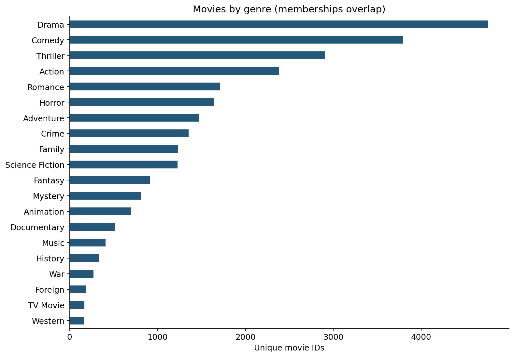

# Movie Catalogue & Genre Analysis

**Python · pandas · Data quality · Exploratory analysis · Business communication**

A Python case study in cleaning overlapping categories and comparing ratings and financial coverage. **Course-based portfolio work by Sharan Kumar Rathod; not a paid client engagement.**

[Business summary](docs/business-summary.md) · [Executed notebook](notebooks/movie_genre_analysis.ipynb) · [Aggregate tables](outputs/) · [Methodology](docs/review-notes.md)

## The question

How do genre coverage, ratings, and reported financial measures vary across a movie catalogue, and where could data quality mislead a decision?

## Findings and implications

| Finding | Evidence | Decision implication |
|---|---|---|
| Genre memberships overlap | Drama 4,760; Comedy 3,793; Thriller 2,907 | Do not add genre counts to estimate catalogue size. |
| Financial coverage is limited | 3,854 of 10,865 unique movies have positive budget and revenue | Treat financial comparisons as a selected subset. |
| Counts and rates tell different stories | Drama: 21 / 2,057 eligible movies; Documentary: 7 / 87 | Show the denominator before comparing high-rating prevalence. |
| The extract is historical | Release years 1960–2015 | Use it to demonstrate analytical methods; refresh the data for a current business decision. |



## What this demonstrates for a client

A handoff containing documented data checks, clear metric definitions, reproducible Python code, charts, aggregate CSV tables, and recommendations bounded by the evidence. These are examples of deliverables for a scoped data-cleaning and exploratory-analysis assignment.

## Analytical approach

1. Remove one exact duplicate and require a unique, non-null movie identifier: 10,866 source rows become 10,865 movies.
2. Expand pipe-separated genres while keeping one record per movie–genre pair; identify 23 movies without genre information.
3. Restrict financial analysis to positive budget and revenue. Report revenue minus budget as a gross surplus proxy, not net profit.
4. Compare rating counts and rates using at least 50 votes and a rating of at least 8; calculate correlations at movie level and suppress genre/year financial cells with fewer than five observations.

## Run locally

Clone or download this repository. The supplied input CSVs are in `data/`.
Use Python 3.12 (the recorded validation environment):

```bash
python -m venv .venv
# macOS/Linux:
source .venv/bin/activate
# Windows PowerShell alternative: .venv\Scripts\Activate.ps1
python -m pip install -r requirements.txt
python analysis.py
```

Run commands from the repository root. The script also supports an absolute file path from another directory. It writes aggregate tables and charts to `outputs/`. For a headless environment, set `MPLBACKEND=Agg`.

To explore interactively, run `jupyter lab` and open `notebooks/movie_genre_analysis.ipynb`. To check a native kernel:

```bash
jupyter nbconvert --execute --to notebook --output verified.ipynb notebooks/movie_genre_analysis.ipynb
```

The saved notebook contains results. Download `notebook-preview.html` and open it locally for an HTML view; GitHub displays HTML source rather than hosting that page.

## Repository guide

| Location | Purpose |
|---|---|
| `analysis.py` | Standalone analysis and output generation |
| `notebooks/` | Narrative analysis with saved tables and figures |
| `data/` | Inputs and source notes |
| `outputs/` | Aggregate results and charts |
| `docs/business-summary.md` | Findings, recommended next step, and handoff scope |
| `docs/reproducibility.json` | Input hashes and recorded package versions |

## Limits of the evidence

Genres overlap and are not independent groups. Financial data is incomplete and potentially selective; values are nominal, with unverified currency/adjustment conventions. Revenue minus budget excludes other costs and is not net profit. Historical correlations do not establish causation, predictive performance, or investment returns. Small samples can produce unstable rates.

## Attribution and validation

The author identifies this as Alex the Analyst coursework. Original lesson and dataset URLs remain to be confirmed; dataset authorship is not claimed. See [data provenance](data/README.md). The repository's code license does not establish redistribution rights for third-party datasets or case materials.

The uploaded project files matched the previously reviewed package byte-for-byte. Both standalone scripts were rerun against those inputs during this review. Notebook code had previously executed sequentially with saved outputs and format validation; native Jupyter-kernel execution remains unverified because the earlier environment blocked kernel sockets. See [review notes](docs/review-notes.md).
