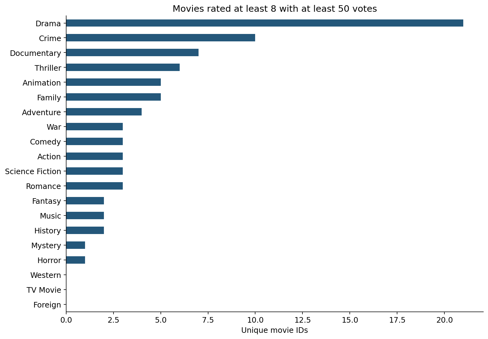

# Movie Genre Analysis with Python
**pandas · Multi-label genres · Financial-data quality · Descriptive associations**

[Open the executed notebook](notebooks/movie_genre_analysis.ipynb) · [Methodology and review](docs/review-notes.md)

## Questions
Which genres are most common? How do reported budget, revenue, popularity, and high-rating prevalence vary? How are ratings and financial measures associated at movie level?

## Verified findings
- Source: **10,866 rows**; **10,865 unique movies** after removing one exact duplicate.
- **23 movies lack genre information**. Genres overlap, so genre counts must not be summed as unique movies.
- Only **3,854 movies** have positive budget and revenue; financial results describe this selected subset.
- Drama has **4,760 movies**, followed by Comedy (**3,793**) and Thriller (**2,907**).
- Drama has **21 movies** rated at least 8 with at least 50 votes, among **2,057 eligible Drama movies** (about **1.02%**).
- Documentary has **7 of 87 eligible movies** meeting the same threshold (about **8.05%**). Highest count and highest rate answer different questions; small samples and coverage matter.




## Corrections
Unique movie IDs replace titles and distinct rating values for counting. `explode` replaces the older split/stack pattern. Financial comparisons require positive budget and revenue. Revenue-minus-budget is labeled a gross surplus proxy, not net profit. Associations use one row per movie and report sample sizes. Genre/year financial cells below five observations are suppressed.

## Run
Use Python 3.10+ and put the supplied `imdb_movies.csv` in `data/`:
```bash
python -m pip install -r requirements.txt
python analysis.py
```
Or open the notebook in Jupyter and run all cells. The handoff includes the data; `.gitignore` excludes row-level input CSV files by default pending original-source/reuse confirmation.

## Limitations
The observed release years span 1960–2015. The notebook uses nominal budget/revenue fields; adjusted fields are not used because their adjustment basis is not documented here. Financial missingness is substantial and likely selective. Overlapping genres are not independent portfolios. Correlations do not establish causal effects or reliable investment returns.

## Attribution
Course-practice project by **Sharan Kumar Rathod**, identified by the author as Alex the Analyst coursework. Exact lesson and original dataset URLs remain to be confirmed. This revision improves analytical definitions, reproducibility, and interpretation; no original data collection or client impact is claimed.

## Validation
Every code cell executed sequentially against the supplied CSV, and notebook-format validation passed. Native Jupyter-kernel execution was blocked by this workspace's socket restrictions. Charts and aggregate output tables are saved for review; perform Restart & Run All locally as a final environment check.
